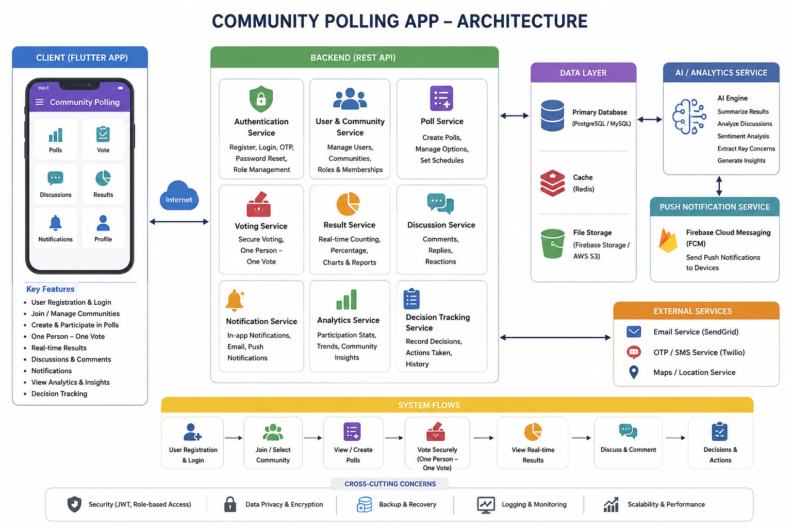
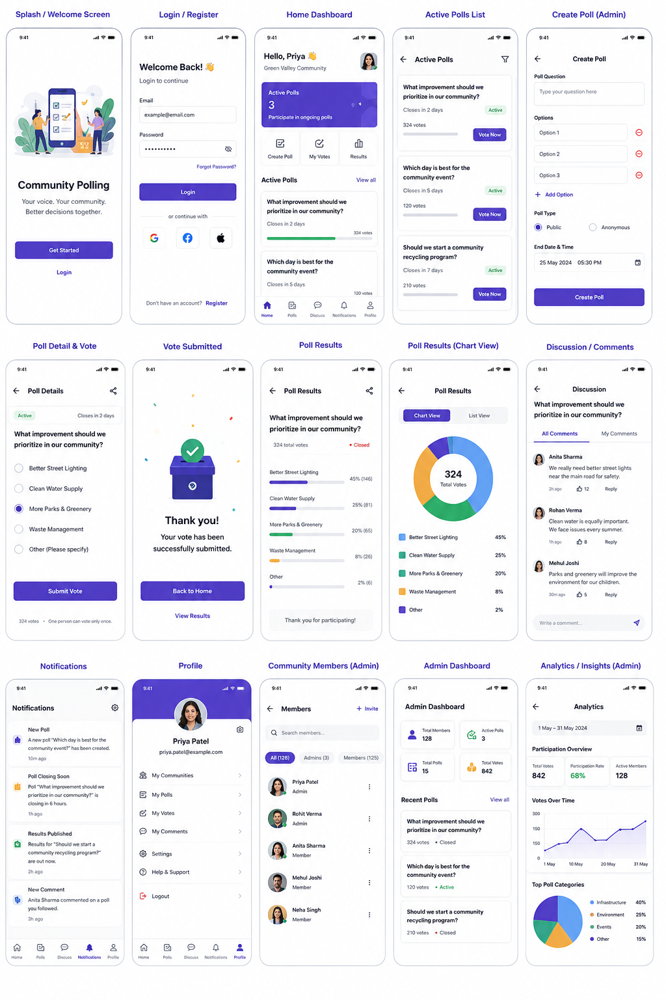

# 🗳️ Community Polling App (CPA)

> **Your voice. Your community. Better decisions together.**

[](https://flutter.dev)
[](https://dart.dev)
[](https://firebase.google.com)
[](LICENSE)
[](CONTRIBUTING.md)

---

## 📌 Overview

**Community Polling App (CPA)** is a modern, transparent, community-driven decision-making platform built with **Flutter**. It is designed to bridge the gap between community members and leadership by democratizing local governance. Whether for residential communities, clubs, student associations, or organizations, CPA provides a secure and real-time environment to create polls, cast votes, deliberate through discussions, and track resolutions.

---

## 📸 Previews & Architecture

### System Architecture


### App Interface & Experience


---

## ✨ Key Features

- **📊 Intelligent Polling Engine**:
  - Create polls with customizable titles, descriptions, categories, and deadlines.
  - Filter polls across categories: *Infrastructure, Environment, Events, Safety & Security, Finance & Budget, Recreation, and more*.
  - Real-time vote percentage calculation with animated progress indicators.

- **📈 Visual Analytics & Insights**:
  - Interactive custom Donut Charts and Line Charts built with dedicated Flutter painters (`CustomPainter`).
  - Clear breakdown of option distributions and voter turnout.

- **💬 Pre-Vote Deliberation & Discussions**:
  - Each poll includes an integrated discussion forum.
  - Allows members to debate perspectives and ask questions before voting.

- **📋 Decision Tracking Workflow**:
  - Poll outcomes are not just numbers—admins can convert closed poll results into actionable **Community Decisions**.
  - Track decision lifecycle statuses: `Proposed` ➔ `In Progress` ➔ `Implemented`.

- **🛡️ Role-Based Administration**:
  - Dual-role experience: **Admins** and **Members**.
  - Admin dashboard with high-level statistics: participation rate, active polls, total votes.
  - Member management screen with role promotion/demotion and moderation tools.
  - Protected poll deletion dialogs.

- **🔔 In-App Notification Center**:
  - Real-time alerts for newly created polls, upcoming vote deadlines, and official decision status updates.

- **⚡ Cloud Realtime Sync & Offline Mock Fallback**:
  - Powered by **Firebase Realtime Database** for live synchronized updates across all clients.
  - Built-in `MockDataService` fallback allowing instant testing and demonstration without network configuration.

---

## 🏗️ Architecture & Directory Structure

The project follows a clean, feature-driven and provider-backed architecture:

```text
lib/
├── core/
│   ├── constants/            # App constants, category lists, configuration
│   ├── theme/                # AppTheme, AppColors, AppTypography (Material 3)
│   └── utils/                # CustomPainters, DateFormatter
├── models/                   # Data models (Poll, Vote, Comment, Decision, User, Analytics)
├── providers/                # Provider state management (Auth, Community, Poll, Discussion, etc.)
├── screens/
│   ├── admin/                # AdminDashboard, CommunityMembers, DecisionTracking, Analytics
│   ├── auth/                 # Login, Register, Welcome screens
│   ├── community/            # CommunitySelection screen
│   ├── discussion/           # Poll discussion and comment threads
│   ├── main/                 # MainShell navigation bar and HomeDashboard
│   ├── notifications/        # Real-time notifications screen
│   ├── polls/                # ActivePolls, CreatePoll, PollDetail, PollResults, VoteConfirmation
│   └── profile/              # UserProfile, UserPolls, UserVotes
├── services/                 # RealtimeDatabaseService (Firebase) & MockDataService
├── widgets/
│   ├── admin/                # MemberTile, MetricStatCard
│   ├── charts/               # DonutChartWidget, LineChartWidget
│   ├── common/               # CustomButton, CustomTextField, StatusBadge, UserAvatar
│   ├── discussions/          # CommentTile
│   └── polls/                # CategoryChip, PollCard, PollProgressBar, DeletePollDialog
├── firebase_options.dart     # Firebase configuration
└── main.dart                 # Application entry point & MultiProvider initialization
```

---

## 🚀 Tech Stack

| Component | Technology |
|---|---|
| **Framework** | [Flutter](https://flutter.dev) (v3.x / SDK `^3.12.2`) |
| **Language** | [Dart](https://dart.dev) |
| **State Management** | [Provider](https://pub.dev/packages/provider) |
| **Database** | [Firebase Realtime Database](https://firebase.google.com/products/realtime-database) |
| **Fonts & Icons** | [Google Fonts](https://pub.dev/packages/google_fonts), [Cupertino Icons](https://pub.dev/packages/cupertino_icons) |
| **Local Storage** | [Shared Preferences](https://pub.dev/packages/shared_preferences) |
| **Utilities** | [intl](https://pub.dev/packages/intl), [uuid](https://pub.dev/packages/uuid) |
| **Linting** | [flutter_lints](https://pub.dev/packages/flutter_lints) |

---

## 🛠️ Getting Started

### Prerequisites

- [Flutter SDK](https://docs.flutter.dev/get-started/install) (`>= 3.12.2`)
- [Dart SDK](https://dart.dev/get-dart)
- An IDE such as [VS Code](https://code.visualstudio.com/) or [Android Studio](https://developer.android.com/studio)
- Git

### Installation

1. **Clone the repository**:
   ```bash
   git clone https://github.com/devivaddadi/community_polling.git
   cd community_polling
   ```

2. **Install Flutter dependencies**:
   ```bash
   flutter pub get
   ```

3. **Verify Flutter environment**:
   ```bash
   flutter doctor
   ```

4. **Run the application**:
   ```bash
   flutter run
   ```

---

## ⚙️ Firebase Setup & Environment Security

The application includes a `RealtimeDatabaseService` configured for Firebase Realtime Database. By default, it connects using compile-time variables or seamlessly falls back to the built-in local mock data service.

### 🔐 Keeping Secrets Safe
API keys and project credentials are never hardcoded. They are loaded via compile-time environment variables (`--dart-define`):
1. Review the provided `.env.example` file.
2. Run or build the app with your keys:
   ```bash
   flutter run \
     --dart-define=FIREBASE_API_KEY=your_api_key \
     --dart-define=FIREBASE_PROJECT_ID=your_project_id \
     --dart-define=FIREBASE_DATABASE_URL=https://your-project-default-rtdb.firebaseio.com
   ```

### Connecting to Your Firebase Project
1. Create a Firebase project at the [Firebase Console](https://console.firebase.google.com).
2. Enable **Firebase Realtime Database**.
3. Set up standard Realtime Database security rules:
   ```json
   {
     "rules": {
       ".read": "auth != null",
       ".write": "auth != null"
     }
   }
   ```
4. Or generate platform-specific configuration using FlutterFire CLI:
   ```bash
   flutterfire configure
   ```

---

## 🧪 Testing

Run static analysis to verify code quality:
```bash
flutter analyze
```

Execute unit and widget test suites:
```bash
flutter test
```

---

## 🤝 Contributing

Contributions, feature ideas, and pull requests are warmly welcomed! Please read through our [Contributing Guidelines](CONTRIBUTING.md) and [Code of Conduct](CODE_OF_CONDUCT.md) before submitting a pull request.

---

## 📄 License

This project is licensed under the MIT License - see the [LICENSE](LICENSE) file for details.

---

## 👤 Author

**Devi Vaddadi**
- GitHub: [@devivaddadi](https://github.com/devivaddadi)
- Repository: [community_polling](https://github.com/devivaddadi/community_polling)
